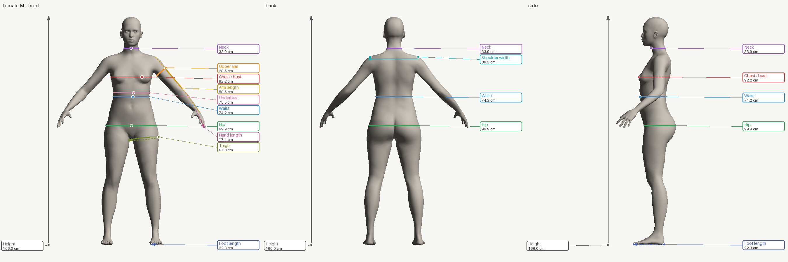
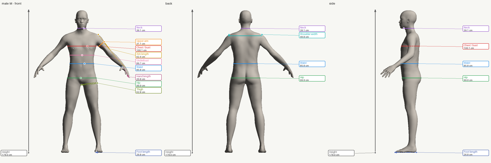

# Taking measurements (cm)

The pictures are generated from the avatars: each line is the exact path the program measures
(solid = visible side, dashed = behind the body; dot = where the tape starts, arrow = where it ends).
Every run on a realistic avatar writes the same sheet for *your* avatar as `measurement_guide.png`.

Wear thin clothes, stand relaxed, tape snug but not pulling. Have someone help for the back.

| Field | How |
|---|---|
| sex | `female` or `male`: picks the body model. |
| height | Barefoot, against a wall, floor to top of head. |
| chest | Around the fullest part of the chest/bust, under the arms, tape level all the way round. Arms down. |
| waist | Around the natural waist (narrowest point, usually just above the navel). Don't hold your breath. |
| hip | Around the fullest part of the seat (where it sticks out most), feet together. |
| shoulder_width | Across the back from one shoulder point (bony tip at the top of the arm) to the other, along the curve of the back just below the shoulder line. |
| neck | Around the base of the neck, where a collar sits. One finger under the tape. |
| upper_arm | Around the fullest part of the bicep, arm relaxed at your side. |
| arm_length | Shoulder point, over the outside of the elbow, to the wrist bone. |
| thigh *(optional)* | Fullest part of the upper thigh. |
| underbust *(optional)* | Directly under the bust. |

Then:

    python run_demo.py --measurements measurements/me.json            # avatar from you, default tee
    python run_demo.py --measurements measurements/me.json --draft    # tee drafted to you

The program measures the avatar back with a virtual tape and prints input vs avatar,
so you can see it matched. Typos are caught (e.g. inches entered as cm).
